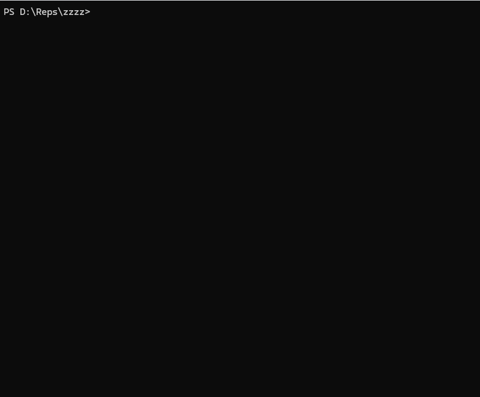

# xvault

xvault keeps secrets inline in the configuration files and Markdown notes you already use. Mark only the values that are secret, edit the file with xvault, and it stores those values as single-line ciphertext while leaving the rest of the file readable.

It is a local-first, Git-friendly tool: the same file can hold configuration, notes, and encrypted values, rather than splitting them across a vault and a separate configuration file.


## Why xvault?

- Keep a single source of truth for configuration and notes.
- Encrypt only explicit secret markers, so ordinary diffs remain useful.
- Work locally with a password and, optionally, the operating system keyring.
- Export decrypted files or resolve file-local variable references when a tool needs a materialized configuration.

[SOPS](https://github.com/getsops/sops) is a stronger fit for GitOps workflows that already use cloud KMS, PGP, or age. [git-crypt](https://github.com/AGWA/git-crypt) is useful when whole files should be encrypted transparently. xvault instead focuses on explicit inline values in local configuration and notes.

## Quick start

Install xvault:

```bash
pip install xvault
```

Create `dev.env`:

```env
DB_HOST=localhost
DB_USER=enc:app
DB_PASS=${enc:choose-a-strong-password}
DATABASE_URL=postgres://${var:DB_USER}:${var:DB_PASS}@localhost/app
```

Open it with xvault and save the edit. xvault asks for a password when it needs one and writes the metadata and encrypted values on save:

```bash
xvault edit dev.env
```

The short demo below shows the editing workflow:



Read a value or export a decrypted copy for a command that needs it:

```bash
xvault get dev.env DB_PASS
xvault export dev.env --resolve
```

Treat exported output as plaintext. See the [usage guide](docs/usage.md) for the complete workflow and command behavior.

## Features

- Inline `enc:` and `${enc:...}` secret markers.
- JSON, JSONC, YAML, ENV, Markdown, and OpenVPN configuration support.
- Envelope encryption for new vaults: a random AES-256-GCM data key protected by an Argon2id password-derived key.
- Optional file-local `${var:NAME}` resolution during `get` and `export`.
- `edit`, `get`, `set`, `export`, `info`, `validate`, `unlock`, `lock`, `rekey`, and explicit v1-to-v2 `upgrade` commands.
- Optional OS-keyring cache for derived keys.

## Supported formats

Verified handlers are available for `.json`, `.jsonc`, `.yaml`, `.yml`, `.env`, `.md`, and `.ovpn`. The detailed per-format behavior and limitations are in the [file-format reference](docs/reference.md).

## Documentation

- [Usage guide](docs/usage.md)
- [File-format reference](docs/reference.md)
- [Internals and security model](docs/internals.md)
- [Engineering case study](docs/engineering-case-study.md) — Architecture evolution, design decisions, trade-offs, and interoperability.
- [Rekey benchmark](docs/rekey-benchmark.md) — Measured CryptoV1 vs. CryptoV2 password-rotation behavior.

CryptoV1 files remain readable and writable and are upgraded only by the explicit
`xvault upgrade` command. New vaults use CryptoV2 envelope encryption: a
password-derived key protects a random data key, and that data key encrypts the
marked values. The versioned file contract is documented in the
[reference](docs/reference.md#interoperability-contract).

## Security

xvault encrypts marked values and authenticates their ciphertext, but it does not make plaintext configuration trustworthy, protect a compromised machine, or make plaintext exports safe. Use a strong unique password and consider `--no-cache-key` on shared, remote, or headless systems. Read the [security model](docs/internals.md#security-model) and [vulnerability-reporting policy](SECURITY.md).

## Verification

The test suite covers CryptoV1 and CryptoV2 fixtures, password rotation,
explicit migration, metadata failure handling, transactional writes, CLI
behavior, and every supported handler. CI tests Python 3.12 and 3.13 on Linux,
plus Python 3.12 compatibility on Windows and macOS, and validates wheel and
source distributions.

## Roadmap

Potential future work includes editor improvements, richer Markdown and binary workflows, more selective exports, and optional integrations. These are not implemented features or compatibility commitments.

## License

xvault is released under the [MIT License](LICENSE).
