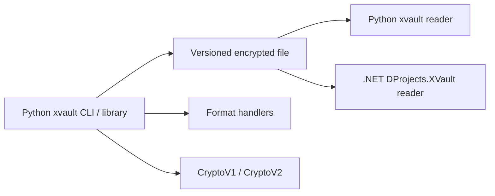

# Engineering case study: Evolving xvault into a versioned, cross-language secrets format

> **Scope:** An independently developed, local-first developer tool. xvault is currently used in my own workflow; this case study demonstrates architectural decisions and testable system properties, **not** organizational adoption or independently audited security.

## The problem: protect secrets without obscuring the rest of the file

Many configuration files mix sensitive values with ordinary settings. Encrypting an entire file protects its contents, but also makes routine review, editing, and Git diffs less useful. Maintaining a separate secrets file avoids that problem for configuration review, but introduces another artifact to keep in sync.

I built **xvault** around a narrower requirement: retain a familiar text file while encrypting only values explicitly marked as secrets. Developers can keep non-sensitive settings and documentation readable, and decrypt or export the marked values when a consuming tool needs them.

The primary constraints shaped the design:

- **Local-first:** No cloud service or central key-management infrastructure is required.
- **Git-friendly:** Non-sensitive content remains readable, and routine secret-management operations should avoid unnecessary ciphertext changes.
- **Format-aware:** The same model should work with JSON, JSONC, YAML, ENV, Markdown, and OpenVPN files, without pretending they have identical editing semantics.
- **Backward-compatible:** Evolving cryptography must not silently invalidate existing files.
- **Interoperable:** A consumer written in another language should be able to decrypt a file without embedding the Python application.
- **Fail safely:** Authentication, parsing, and file-writing failures must not silently replace key material or corrupt the stored vault.

This is intentionally **not** a replacement for a centralized enterprise secrets platform, a multi-user key distribution system, or whole-file authenticated encryption.

## Architecture: separate the file format, cryptography, and workflow

The Python implementation has a small set of responsibilities:

| Component | Responsibility |
| --- | --- |
| `XVault` | File lifecycle, editing, keyring integration, validation, migration, and atomic persistence |
| Format handlers | Locate metadata and marked values; perform format-specific parsing and serialization |
| `CryptoV1` / `CryptoV2` | Version-specific key handling and authenticated value encryption |
| Versioned `_xvault` metadata | Select the cryptographic scheme and store the information required to decrypt it |
| `DProjects.XVault` (.NET) | Independently **read** the format for application configuration, without implementing vault management |

The important boundary is the **on-disk contract**, not a shared codebase. A .NET application can consume encrypted configuration through a separate reader; it does not need the Python editor, migration logic, or password-rotation implementation.

### Decision 1: inline markers instead of whole-file encryption

An explicit `enc:` or `${enc:...}` marker identifies a value to encrypt. This preserves the surrounding file structure and keeps ordinary changes visible in Git. It also supports use cases beyond application settings, such as notes and OpenVPN profiles.

The alternative—encrypting the complete document—would give stronger protection to the document's structure, but conflict with the primary readability goal. Tools such as SOPS or git-crypt may be better choices when whole-file handling, GitOps integration, or external key-management systems are the actual requirements.

**Cost of this decision:** xvault does not authenticate unmarked fields, document structure, or the location of a secret. Its marker matching is textual and therefore has format-specific limitations. These are protocol constraints, not implementation details to hide.

### Decision 2: evolve from a direct encryption key to envelope encryption

In CryptoV1, Argon2id derives a key from the password and salt, and that key encrypts marked values directly. Changing the vault password therefore requires rewriting encrypted values.

CryptoV2 introduces two separate keys:

1. Argon2id derives a **key-encryption key (KEK)** from the password and a per-vault salt.
2. A random **data-encryption key (DEK)** encrypts marked values using AES-256-GCM.
3. The KEK authenticates and wraps the DEK, which is stored as `encrypted_key` in the versioned metadata.

This separation changes the operational behavior of password rotation. V2 `rekey` derives a new KEK and rewraps the **same DEK**. It changes the salt and wrapped-key metadata while leaving secret ciphertext unchanged. This is valuable for Git-managed files: password maintenance need not create changes to every encrypted field.

**Cost of this decision:** password rekey is not DEK rotation. It does not revoke access to historical Git revisions, nor does it recover from a compromised DEK. Those would require a different key-rotation and recovery strategy.

The exact Argon2id parameters, AES-GCM payload layout, and associated-data rules are specified in the [file-format reference](reference.md#interoperability-contract). In particular, the wrapped DEK uses AAD `xvault:v2:dek`, while secret values use **no AAD** to preserve the existing cross-format representation.

### Decision 3: explicit migration rather than silent upgrades

New vaults use CryptoV2; existing CryptoV1 files remain readable and writable. `xvault upgrade` is an intentional operation that decrypts the v1 values, creates a fresh v2 DEK, prepares a complete replacement, verifies the candidate, and commits it atomically.

I preferred explicit migration because a cryptographic format change is a significant compatibility event. Users should be able to review the resulting file changes and choose when to make them. Versioned metadata also lets independent readers select the correct scheme without guessing from a ciphertext token.

**Cost of this decision:** the project must maintain and test both crypto versions. That complexity is deliberate and bounded by a documented file contract.

### Decision 4: treat persistence and keyring caching as separate failure boundaries

A security-oriented file tool must protect data not only from cryptographic errors, but also from failed edits and interrupted saves.

For normal editing and setting values, xvault prepares candidate ciphertext and cryptographic state separately, writes the file through an atomic replacement, and activates the candidate state only after persistence succeeds. Tests inject failures during encryption, serialization, and replacement to verify that the original file and active vault state remain usable.

Keyring caching has a different role. The **file** is the durable source of truth; a cached credential is an optional convenience. If refreshing the keyring fails *after* a successful file write, the tool warns rather than falsely reporting that the file transaction failed. V1 and v2 use distinct keyring identities, and v2 caches the KEK rather than the DEK.

This distinction avoids coupling the integrity of the encrypted file to an operating-system service that may be absent in headless or CI environments.

### Decision 5: a read-only .NET consumer, not a second vault-management product

The independent [`DProjects.XVault`](https://github.com/marcdp/libs/tree/main/src/DProjects.XVault) library decrypts the versioned format for .NET consumers. Its role is intentionally narrower than the Python CLI's: it does not need to create vaults, edit secrets, or implement migration.

The interoperability contract is backed by committed Python-generated fixtures for v1 and v2, including a fixed CryptoV2 test vector. The .NET compatibility tests consume canonical encrypted files rather than verifying only ciphertext produced by their own implementation.

This is the most direct evidence that the format is **implementation-independent**. It shows technical reuse across language boundaries, although it does not establish adoption by external teams.

## Engineering evidence: what can be inspected

The repository supports the design claims with source and regression tests rather than performance or adoption claims.

| Claim | Evidence in the repositories |
| --- | --- |
| CryptoV1 remains supported | [`tests/fixtures/v1.env`](../tests/fixtures/v1.env) and the v1 compatibility tests |
| CryptoV2 has a stable serialized representation | [`tests/fixtures/v2.env`](../tests/fixtures/v2.env), [`CryptoV2`](../src/xvault/crypto/v2.py), and the [format reference](reference.md) |
| Password rotation can leave secret ciphertext unchanged | CryptoV2 password-rotation tests and the separate .NET before/after rekey fixtures |
| Failed persistence is handled intentionally | Edit, set, keyring-failure, and atomic-replacement regression tests in [`tests/`](../tests/) |
| Malformed metadata fails closed | Handler and metadata-validation tests, including absent-versus-malformed cases |
| File formats and crypto versions remain separate | [`handlers/`](../src/xvault/handlers/), [`crypto/`](../src/xvault/crypto/), and [`xvault.py`](../src/xvault/xvault.py) |
| Independent language interoperability is tested | [DProjects.XVault compatibility tests](https://github.com/marcdp/libs/blob/main/test/DProjects.XVault.Test/XVaultCompatibilityTests.cs) |

The [CI configuration](../.github/workflows/ci.yml) includes Python 3.12/3.13 testing on Linux, Python 3.12 testing on Windows and macOS, and build/installation checks for distributions. A configured pipeline is not a substitute for inspecting the results of a particular run. This case study does **not** claim that an independent security audit or formal protocol verification has been performed.

A useful further experiment is to benchmark v1 versus v2 password rotation at several vault sizes and publish the test conditions, execution times, and Git diff sizes. The architecture predicts less ciphertext churn for v2; numerical performance claims should wait until they are measured.

## Security boundaries and accepted trade-offs

The intent is to make guarantees explicit rather than imply that a locally encrypted file is a complete secrets-management system.

- **Selective confidentiality:** only marked values are encrypted; surrounding content remains visible.
- **Value-level authentication:** AES-GCM protects encrypted token contents, but the document and each field's identity are not authenticated. A valid token can be moved between positions in the same vault.
- **Local trust boundary:** a compromised machine, editor, process, or accessible keyring credential can expose secrets.
- **Plaintext output:** editing, `get`, and `export` necessarily materialize plaintext; redirected files and terminal output require appropriate care.
- **Historical access:** changing the current password does not revoke credentials that can decrypt older repository revisions.
- **Security assurance:** the implementation uses established cryptographic primitives but has not undergone an independent security audit.

See the [security model](internals.md#security-model) and [security policy](../SECURITY.md) for the operating assumptions and reporting process.

## What I would change under different requirements

The current design is appropriate for a personally used, local-first workflow. Different constraints would justify a different architecture:

- **Multiple users or teams:** introduce explicit identity, key distribution, revocation, and recovery requirements before choosing a sharing model.
- **Centralized operational control:** evaluate a managed secrets system or KMS-backed tooling instead of extending a local password/keyring mechanism by default.
- **Authenticated document structure:** define a new protocol version with field- or document-bound authentication and a migration plan; do not silently reinterpret v2 ciphertext.
- **Stronger release assurance:** add externally reviewed security analysis and operational adoption evidence, rather than treating test coverage alone as proof of security.

These are conditional design choices, not an expansion roadmap for the current product.

## Outcome and reflection

xvault began as a small workflow tool, but evolving it exposed broader engineering problems: how to change a persisted protocol safely, how to separate durable state from convenience services, how to preserve user-owned content, and how to make a file format independently consumable.

The most important result is a **testable set of system properties**: existing v1 files remain supported; new files use v2 envelope encryption; v2 password rotation need not rewrite secret ciphertext; failure paths are explicitly exercised; and a separate .NET reader consumes the same protocol.

Its usage is currently personal, so I do not claim team productivity gains, organizational adoption, or ecosystem impact. The project is evidence of **architectural judgment, compatibility management, security trade-off analysis, and end-to-end technical ownership**. Impact beyond that would require downstream usage and measured outcomes.

---

**Further reading:** [Usage guide](usage.md) · [File-format and interoperability contract](reference.md) · [Internals and security model](internals.md) · [Changelog](../CHANGELOG.md)

[Back to xvault](../README.md)