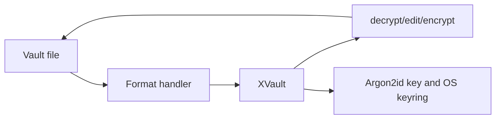

# Internals and security model

## Architecture

xvault is a small Python package with one public class, `XVault`, and a CLI entry point in `xvault.__main__`. The CLI constructs `XVault` for a file and delegates editing, lookup, export, validation, locking, and rekeying to it.

`xvault.xvault` selects a handler from the filename extension. A handler reads and writes metadata, finds secret markers, and—in formats that implement it—looks up or sets values. `XVault` owns key derivation, encryption, decryption, variable resolution, and OS-keyring access. Editing uses `XEditor` from the `dprojectstools` dependency to present decrypted text in the terminal.



The normal lifecycle is: load the file; parse its metadata; obtain a derived or cached key when an operation needs one; decrypt markers; edit, read, or export; then encrypt marked values and write metadata when saving. `export` and `get` do not modify the input file.

## Cryptography

Crypto version 1 derives a 32-byte key with Argon2id from the user password, a 16-byte random salt, time cost 5, memory cost 131072 KiB, and parallelism 4. It encrypts each marked UTF-8 value independently with AES-256-GCM and a fresh 12-byte random nonce. The stored payload is URL-safe base64 of the nonce followed by AES-GCM ciphertext and authentication tag.

Metadata contains the salt, crypto version, and an encrypted check value. The check value verifies a password or cached key before use. See the precise on-disk representation in [reference.md](reference.md).

## Key management

The password is used to derive a key and is then cleared from the `XVault` instance. Derived keys can remain in process memory for the duration of the operation. `unlock` writes a base64-encoded derived key to the operating system keyring under an entry based on the file's absolute URI; `lock` removes it. `rekey` decrypts the current marked values, derives a new key from the new password using the existing salt, then saves new ciphertext and refreshes the cache unless `--no-cache-key` is used.

Keyring behavior depends on the active platform backend. It can be unavailable in remote or headless environments, and cached keys are valuable secrets in their own right.

## Security model

### Goals

xvault aims to keep explicitly marked values encrypted at rest in a readable, Git-friendly source file. AES-GCM detects modifications to each stored secret value when it is decrypted. A strong password and the Argon2id work factor make offline guessing harder than direct hashing.

### What it does not protect

- A weak, reused, or disclosed password.
- A compromised machine, terminal, Python process, or editor session.
- An attacker who can use or extract an unlocked OS-keyring entry.
- Plaintext written by `get`, `export`, terminal scrollback, or redirected output.
- Integrity or confidentiality of unmarked file content, metadata placement, file names, or the overall file structure. AES-GCM has no associated data in this implementation.

Use a strong unique passphrase, keep working copies on trusted machines, use `--no-cache-key` where appropriate, and inspect output and Git diffs. xvault has not been represented here as independently security audited.

## Development

The source package is in `src/xvault/`; tests are in `tests/`; committed sample formats are in `examples/`. Install a checkout for development with:

```bash
pip install -e ".[test]"
python -m pytest -q
```

GitHub Actions runs the pytest suite on Ubuntu with Python 3.10 for pushes to `main` and pull requests. The repository also includes `p.py`, an intentional local development utility. It provides commands for editable installation and for building or publishing distributions with local PyPI credentials sourced through xvault. It is not part of the installed package workflow and should remain in place.

The release helper invokes `py -m build` and `py -m twine upload dist/*`; its comments describe the required local setup and manual version increase. The CI workflow currently tests rather than building or publishing releases.
