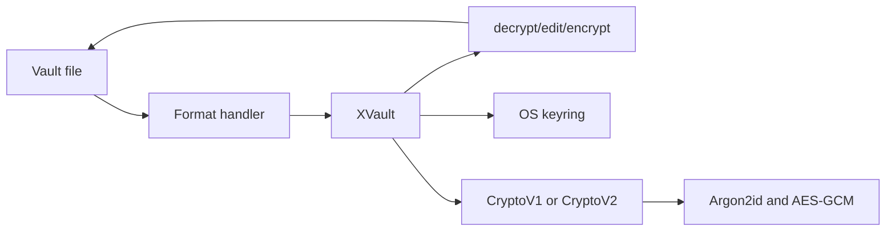

# Internals and security model

## Architecture

xvault is a small Python package with one public class, `XVault`, and a CLI entry point in `xvault.__main__`. The CLI constructs `XVault` for a file and delegates editing, lookup, export, validation, locking, and rekeying to it.

`xvault.xvault` selects a handler and orchestrates file operations, marker processing, variable resolution, atomic replacement, version selection, and OS-keyring access. `xvault.meta` owns the version-aware metadata representation. Handlers only place metadata, find markers, and parse or serialize their file syntax. `xvault.crypto.v1` preserves the original direct-key scheme. `xvault.crypto.v2` owns KEK derivation, DEK generation and wrapping, value encryption, and password-rotation candidates. `xvault.crypto.base` exposes only validation, value encryption/decryption, replacement-password compatibility, and a version-appropriate cacheable credential. Editing uses `XEditor` from `dprojectstools`.

The handler modules are `json`, `jsonc`, `yaml`, `env`, `markdown`, and `ovpn`. Handler classes and metadata names remain re-exported from `xvault.xvault` for compatibility with existing Python imports.



The normal lifecycle is: load the file; parse its metadata; obtain a derived or cached key when an operation needs one; decrypt markers; edit, read, or export; then encrypt marked values and write metadata when saving. `export` and `get` do not modify the input file.

## Cryptography

Both crypto versions derive 32 bytes with Argon2id from the password and a 16-byte salt using time cost 5, memory cost 131072 KiB, and parallelism 4. V1 uses the result directly for value encryption and retains its encrypted check value.

V2 treats the derived key as a KEK. Initialization generates one random 32-byte DEK, wraps it with AES-256-GCM using the KEK, a fresh 12-byte nonce, and AAD `xvault:v2:dek`, then stores the wrapped DEK in metadata. The DEK encrypts each marked UTF-8 value with its own random 12-byte nonce and no AAD. Failure to unwrap an existing DEK is always an error; it can never trigger DEK replacement.

Metadata contains the salt, crypto version, and an encrypted check value. The check value verifies a password or cached key before use. See the precise on-disk representation in [reference.md](reference.md).

## Key management

The password is consumed after derivation; derived keys can remain in process memory for the operation. `unlock` caches a base64-encoded v1 key or v2 KEK under version-distinct, file-specific identities. A cached v2 KEK is accepted only if it unwraps the stored DEK. `lock` removes the active identity. `--no-cache-key` prevents all normal keyring reads, writes, and deletions.

V2 `rekey` first authenticates the current DEK, prepares a fresh salt, new KEK, and newly wrapped copy of the same DEK, and atomically writes candidate metadata. Only after that succeeds does it activate the candidate and refresh the keyring. Secret ciphertext is byte-for-byte unchanged. V1 retains its previous full re-encryption behavior. Password rotation does not revoke the ability to decrypt historical Git revisions using their historical password or cached key.

`upgrade` is the only v1-to-v2 path. It requires the password again, decrypts marked values in memory, prepares a fresh v2 DEK and complete candidate representation, verifies that candidate, then atomically replaces the file. A failed preparation or write leaves the v1 file and active object usable.

Keyring behavior depends on the active platform backend. It can be unavailable in remote or headless environments, and cached keys are valuable secrets in their own right.

## Security model

### Goals

xvault aims to keep explicitly marked values encrypted at rest in a readable, Git-friendly source file. AES-GCM detects modifications to each stored secret value when it is decrypted. A strong password and the Argon2id work factor make offline guessing harder than direct hashing.

### What it does not protect

- A weak, reused, or disclosed password.
- A compromised machine, terminal, Python process, or editor session.
- An attacker who can use or extract an unlocked OS-keyring entry.
- Plaintext written by `get`, `export`, terminal scrollback, or redirected output.
- Integrity or confidentiality of unmarked file content, metadata placement, file names, or the overall file structure.
- Authentication of a secret's field identity or location. V2 intentionally uses no field-bound AAD, so valid encrypted values can be moved between marked locations in the same vault.
- Revocation of historical revisions after password rotation. Compromise of a DEK requires full data-key rotation (v1-to-v2 upgrade creates one; v2 password rekey does not).

Use a strong unique passphrase, keep working copies on trusted machines, use `--no-cache-key` where appropriate, and inspect output and Git diffs. Crypto v2 has not undergone an independent security audit.

## Development

The source package is in `src/xvault/`; tests are in `tests/`; committed sample formats are in `examples/`. Install a checkout for development with:

```bash
pip install -e ".[test]"
python -m pytest -q
```

GitHub Actions runs the pytest suite on Ubuntu with Python 3.12 for pushes to `main` and pull requests. The repository also includes `p.py`, an intentional local development utility. It provides commands for editable installation and for building or publishing distributions with local PyPI credentials sourced through xvault. It is not part of the installed package workflow and should remain in place.

The release helper invokes `py -m build` and `py -m twine upload dist/*`; its comments describe the required local setup and manual version increase. The CI workflow currently tests rather than building or publishing releases.
