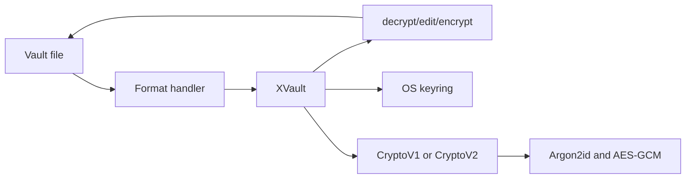

# Internals and security model

## Architecture

xvault is a small Python package with one public class, `XVault`, and a CLI entry point in `xvault.__main__`. The CLI constructs `XVault` for a file and delegates editing, lookup, export, validation, locking, and rekeying to it.

`xvault.xvault` selects a handler and orchestrates file operations, marker processing, variable resolution, atomic replacement, version selection, and OS-keyring access. `xvault.meta` owns the version-aware metadata representation. Handlers only place metadata, find markers, and parse or serialize their file syntax. `xvault.crypto.v1` preserves the original direct-key scheme. `xvault.crypto.v2` owns KEK derivation, DEK generation and wrapping, value encryption, and password-rotation candidates. `xvault.crypto.base` exposes only validation, value encryption/decryption, replacement-password compatibility, and a version-appropriate cacheable credential. Editing uses `XEditor` from `dprojectstools`.

The handler modules are `json`, `jsonc`, `yaml`, `env`, `markdown`, and `ovpn`. Handler classes and metadata names remain re-exported from `xvault.xvault` for compatibility with existing Python imports.



The normal lifecycle is: load the file; parse its metadata; obtain a derived or cached key when an operation needs one; decrypt markers; edit, read, or export; then encrypt marked values and write metadata when saving. `export` and `get` do not modify the input file.

## Cryptography

Both crypto versions derive 32 bytes with Argon2id from the password and a 16-byte salt using time cost 5, memory cost 131072 KiB, and parallelism 4.

CryptoV1 uses that result directly as the value-encryption key. Its encrypted
`check` field authenticates the derived key, and password rotation must decrypt
and re-encrypt every marked value with a newly derived key.

V2 treats the derived key as a KEK. Initialization generates one random 32-byte DEK, wraps it with AES-256-GCM using the KEK, a fresh 12-byte nonce, and AAD `xvault:v2:dek`, then stores the wrapped DEK in metadata. The DEK encrypts each marked UTF-8 value with its own random 12-byte nonce and no AAD. Failure to unwrap an existing DEK is always an error; it can never trigger DEK replacement.

CryptoV2 has no `check` field. Its authenticated `encrypted_key` is the wrapped
DEK; successfully unwrapping it authenticates the password-derived KEK. Password
rotation derives a new KEK and rewraps the same DEK, so value ciphertext does not
change. See the precise on-disk representation in
[reference.md](reference.md#interoperability-contract).

## Key management

The password is consumed after derivation; derived keys can remain in process memory for the operation. Opening an initialized vault with a password automatically authenticates and caches a base64-encoded v1 key or v2 KEK unless caching is disabled. Opening without a password can read that entry. `unlock` explicitly authenticates and writes it. A cached v2 KEK is accepted only if it unwraps the stored DEK. V1 uses `xvault:<file URI>` and V2 uses `xvault:v2:<file URI>`, with username `username`. `lock` removes the active identity but does not erase credentials already loaded into process memory. `--no-cache-key` prevents all keyring reads, writes, and deletions for the invocation.

V2 `rekey` first authenticates the current DEK, prepares a fresh salt, new KEK, and newly wrapped copy of the same DEK, and atomically writes candidate metadata. Only after that succeeds does it activate the candidate and refresh the keyring. Secret ciphertext is byte-for-byte unchanged. V1 retains its previous full re-encryption behavior. Password rotation does not revoke the ability to decrypt historical Git revisions using their historical password or cached key.

`upgrade` is the only v1-to-v2 path. It requires the password again, decrypts marked values in memory, prepares a fresh v2 DEK and complete candidate representation, verifies that candidate, then atomically replaces the file. A failed preparation or write leaves the v1 file and active object usable.

Keyring behavior depends on the active platform backend: normally Credential
Manager on Windows, Keychain on macOS, and a configured Secret Service or other
backend on Linux. It can be unavailable in remote, CI, container, WSL, or
headless environments. Cached derived credentials are valuable secrets in their
own right. Optional cache failure after a successful file commit emits a warning
without rolling back valid data; explicit `unlock` failure remains fatal.

## Design decisions

### Inline encryption versus full-file encryption

Only explicit markers are encrypted so configuration structure, documentation,
and ordinary Git diffs remain useful. This is the core usability trade-off:
unmarked content stays visible and is neither confidential nor authenticated.
Whole-file tools remain preferable when file structure itself is sensitive.

### Argon2id and AES-256-GCM

Argon2id is a memory-hard password KDF intended to raise the cost of offline
guessing. Its parameters are fixed as part of the interoperability contract.
AES-256-GCM provides confidentiality and per-token integrity; unauthenticated
encryption would allow undetected ciphertext modification.

### CryptoV2 envelope encryption and metadata-only rekey

Separating a password-derived KEK from a random DEK allows password rotation to
rewrite only metadata. Preserving the DEK avoids unnecessary ciphertext churn in
Git, but it is not data-key rotation, does not revoke old revisions, and does not
recover from DEK compromise.

### Explicit migration

CryptoV1 files are not silently rewritten. `upgrade` is an intentional,
reviewable operation that creates a new V2 DEK, re-encrypts marked values,
verifies the candidate, and commits atomically. This keeps compatibility and
failure boundaries visible to the user.

### No field-bound AAD

Secret values deliberately use no field name or document path as associated
data, preserving the established cross-format representation. Consequently,
field identity is not authenticated and a valid token may be relocated within
the same vault. A future change would require a new protocol version; V2 is not
silently altered.

### Minimal architecture

Handlers own syntax and metadata placement, crypto versions own their algorithms
and credential state, and `XVault` orchestrates lifecycle and atomic persistence.
No transaction framework or generic key-management hierarchy is needed: edit
prepares isolated candidate state, commits it, then activates it.

### .NET interoperability

`DProjects.XVault` in `marcdp/libs` independently consumes the same versioned
format as a read-only library. It is expected to decrypt the canonical Python
fixtures under `tests/fixtures/`; it does not implement the Python CLI's editing,
keyring, migration, or release workflow and should not be described as feature
equivalent. The normative byte-level details are in the
[interoperability contract](reference.md#interoperability-contract).

## Security model

### Goals

xvault aims to keep explicitly marked values encrypted at rest in a readable, Git-friendly source file. AES-GCM detects modifications to each stored secret value when it is decrypted. A strong password and the Argon2id work factor make offline guessing harder than direct hashing.

### What it does not protect

- A weak, reused, or disclosed password.
- A compromised machine, terminal, Python process, or editor session.
- An attacker who can use or extract an unlocked OS-keyring entry.
- Plaintext written by `get`, `export`, terminal scrollback, or redirected output.
- Integrity or confidentiality of unmarked file content, metadata placement, file names, or the overall file structure.
- Authentication of a secret's field identity or location. V2 intentionally uses no field-bound AAD, so valid encrypted values can be moved between marked locations in the same vault.
- Revocation of historical revisions after password rotation. Compromise of a DEK requires full data-key rotation (v1-to-v2 upgrade creates one; v2 password rekey does not).
- Credentials stored in or already loaded from the OS keyring; treat them as
  sensitive key material.

Use a strong unique passphrase, keep working copies and editor sessions on
trusted machines, use `--no-cache-key` where appropriate, and inspect output and
Git diffs. Redirected plaintext exports require the same care as any other secret
file. CryptoV2 has not undergone an independent security audit.

## Development

The source package is in `src/xvault/`; tests are in `tests/`; committed sample formats are in `examples/`. Install a checkout for development with:

```bash
pip install -e ".[test]"
python -m pytest -q
```

GitHub Actions runs the suite on Python 3.12 and 3.13 on Ubuntu, with Python 3.12 compatibility jobs on Windows and macOS. A separate build job validates the wheel and source distribution and performs a clean wheel import and CLI smoke test. The repository also includes `p.py`, an intentional local development utility. It is not part of the installed package workflow and should remain in place.

The release helper can build and manually upload distributions, but CI never
publishes. A future release workflow should use a separately protected GitHub
environment, an exact version tag, `id-token: write`, and a PyPI Trusted
Publisher configured externally for this repository and workflow. Those PyPI
and GitHub settings cannot be established in source control; no long-lived token
should be added to repository files.
